# SS7 Security in 2026: Research Notes and Tutorial

> [!CAUTION]
> **For education and defense only.** This repository explains how mobile signalling networks work, why they can be abused, and how they are protected. It contains **no** working exploit code, no access instructions, and no step-by-step attack procedure.
>
> Sending crafted signalling messages into a real operator network, tracking someone's location, or intercepting their calls or SMS without authorization is a **serious crime** in almost every country. Examples include the US CFAA and Wiretap Act, the UK Computer Misuse Act and Investigatory Powers Act, India's IT Act 2000 (s.43/66) and Telecommunications Act 2023, and the EU's national laws under the ePrivacy framework. Only do hands-on work in an **isolated lab you own** or under a **written, scoped contract with an operator**.

This guide uses diagrams to explain SS7 signalling security. It covers the 2024–2026 picture: firewalls, bypass techniques, Diameter and 5G. It also clears up some [common myths](#common-myths-and-misconceptions).

---

## Table of contents

1. [TL;DR](#tldr)
2. [Why SS7?](#why-ss7)
3. [How the network fits together](#how-the-network-fits-together)
4. [The protocol stack](#the-protocol-stack)
5. [Why SS7 is vulnerable](#why-ss7-is-vulnerable)
6. [Attack categories (GSMA model)](#attack-categories-gsma-model)
7. [Does it still work in 2026?](#does-it-still-work-in-2026)
8. [Timeline of public incidents and research](#timeline-of-public-incidents-and-research)
9. [Beyond SS7: Diameter, GTP and 5G](#beyond-ss7-diameter-gtp-and-5g)
10. [Defenses](#defenses)
11. [Do's and don'ts](#dos-and-donts)
12. [A safe learning lab](#a-safe-learning-lab)
13. [Common myths and misconceptions](#common-myths-and-misconceptions)
14. [Glossary](#glossary)
15. [References](#references)

---

## TL;DR

- **SS7** (Signalling System No. 7) is the 1970s–80s protocol suite that telephone networks use to set up calls, deliver SMS, and handle roaming between operators.
- It was built for a small, closed club of state-owned carriers, so **it trusts every message from inside the network** and has no built-in authentication.
- Today that "club" is thousands of operators, MVNOs, SMS aggregators, and resellers. Anyone who gets signalling access, legitimately or not, can send messages that look like real roaming traffic.
- **Does it still work in 2026?** Yes, but less often. Most large operators now filter SS7 traffic, so the simplest attacks are usually blocked. Attacks still succeed against poorly protected networks, through filter-bypass tricks, and through access leased from legitimate-looking operators. Public reports from Citizen Lab (April 2026) and Enea (2025, 2026) confirm this.
- **The practical lesson for everyone else:** never treat SMS or phone calls as a secure channel. Use passkeys, authenticator apps, or hardware keys instead of SMS one-time codes, and use end-to-end encrypted apps for sensitive conversations.

---

## Why SS7?

SS7 is still worth studying for three reasons.

**1. It is still everywhere.** 4G and 5G use newer protocols (Diameter and HTTP/2-based SBA), but SS7 is still used for:
- 2G/3G networks, which are still live in many regions and serve as fallback.
- International roaming between operators that have not upgraded.
- SMS delivery and interconnect with legacy networks.
- Interworking functions that translate between old and new protocols. These carry the old trust problem into the new networks.

**2. It is a textbook case of "security by obscurity at global scale."** SS7 shows what happens when a protocol designed for a few trusted parties turns into a commercial network with thousands of members. The same pattern shows up in BGP, email (SMTP), and DNS.

**3. It breaks assumptions that apps depend on.** Banks, messengers, and login systems used SMS as a "second factor" for years because they assumed the phone network was trustworthy. SS7 research is the main reason NIST [deprecated SMS as an authenticator in SP 800-63B](https://pages.nist.gov/800-63-3/sp800-63b.html) (2017, "restricted" status).

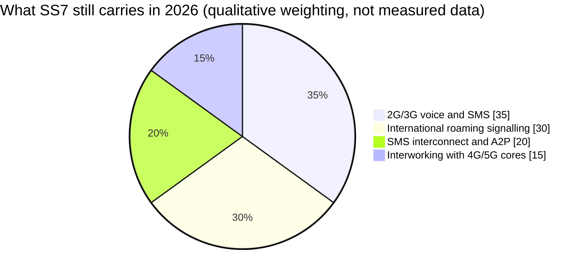

> The pie above is an illustrative weighting to show *where* SS7 lives today. It is not a traffic measurement.

---

## How the network fits together

Inside a mobile network, signalling runs on a separate network from your voice and data. Different operators connect their signalling networks through **interconnect**, either directly or through **IPX/GRX hubs**. That interconnect is the attack surface.

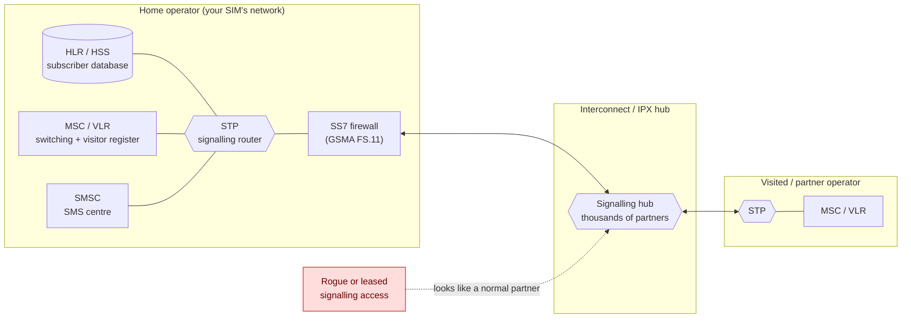

**Key elements**

| Element | Role | Why attackers care |
|---|---|---|
| **HLR / HSS** | Master database: who the subscriber is, where they are registered, what services they have | Holds location pointers and routing data |
| **MSC / VLR** | Switch plus temporary record for subscribers currently in its area | Knows the current cell; routes calls and SMS |
| **SMSC** | Stores and forwards SMS | Delivery path for one-time codes |
| **STP** | Routes signalling messages between nodes and networks | Will forward anything that is well-formed |
| **GT (Global Title)** | The "address" of a node, similar to a phone number for network elements | Can be spoofed or leased |

---

## The protocol stack

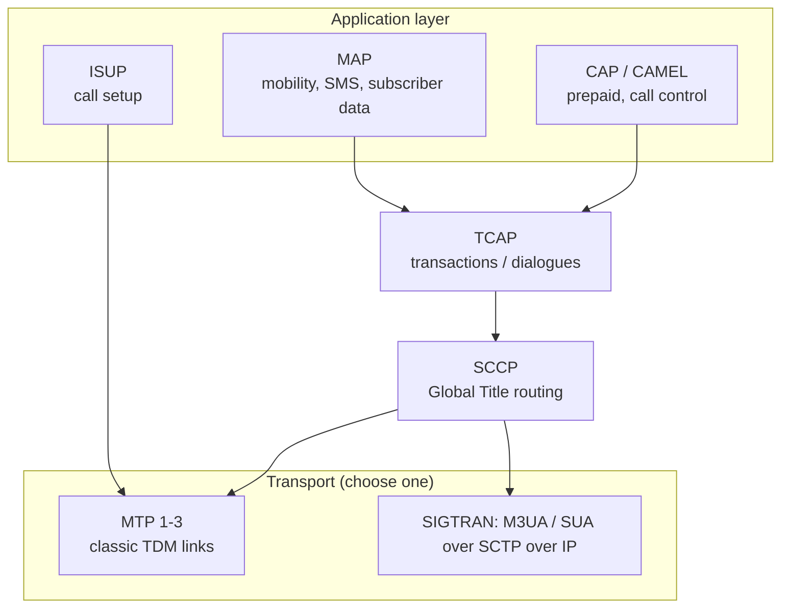

- **MAP** is where nearly all mobile attacks happen. It defines the "verbs" for roaming: where is this subscriber, update their location, deliver this SMS, change their call forwarding.
- **SCCP** routes on Global Titles. It has no proof that the sender actually owns the GT it claims.
- **SIGTRAN** moved SS7 onto IP networks. That made access cheaper and easier and widened the attack surface. It did not add authentication.

---

## Why SS7 is vulnerable

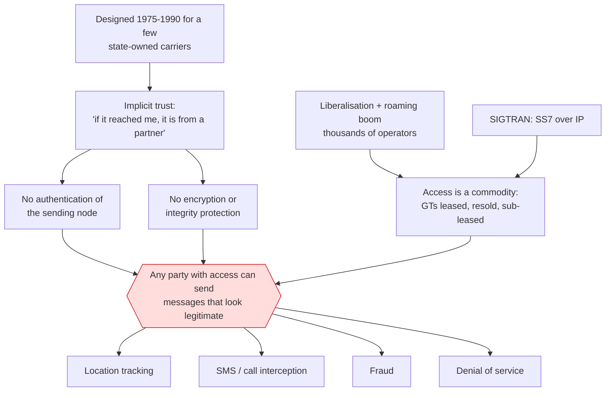

The core problem in one sentence: **a request from a legitimate roaming partner and a request from an attacker using leased access look the same on the wire.** The receiving network has to infer intent from context, such as "does this request make sense, given where we know the subscriber is?"

### How attackers get access (conceptually)

Public reporting describes four main routes. None of them involve "hacking SS7" directly.

1. **Leasing Global Titles** from small operators or resellers that rent out signalling access with little checking. This is the main route described in Citizen Lab's 2026 report and in the 2023–2025 reporting on surveillance vendors.
2. **Compromising an operator**, for example through its roaming or interconnect systems. Enea's November 2026 SilentAir report describes this.
3. **Insiders** at an operator or hub.
4. **Misconfigured or exposed SIGTRAN equipment** on the internet. This is now rare but has been documented.

---

## Attack categories (GSMA model)

The GSMA, the mobile industry body, classifies SS7 messages in **FS.11** by how hard they are to filter. This is the most useful way to understand both attacks and defenses.

```mermaid
flowchart LR
    subgraph C1["Category 1"]
        direction TB
        c1a["Messages that should<br/>NEVER arrive from outside"]
        c1b["Example: AnyTimeInterrogation (ATI)"]
        c1c["Defense: block at the border"]
    end
    subgraph C2["Category 2"]
        direction TB
        c2a["Messages valid only for the<br/>home network's OWN subscribers<br/>when roaming abroad"]
        c2b["Example: ProvideSubscriberInfo,<br/>SendAuthenticationInfo"]
        c2c["Defense: check that the subscriber<br/>really is roaming there"]
    end
    subgraph C3["Category 3"]
        direction TB
        c3a["Messages valid for INBOUND<br/>roamers, which look normal"]
        c3b["Example: UpdateLocation,<br/>InsertSubscriberData"]
        c3c["Defense: plausibility checks,<br/>velocity / geography correlation"]
    end
    C1 -->|"harder to filter"| C2 -->|"hardest to filter"| C3
```

### What each attack class does

| Goal | Abused MAP operations (public, from 3GPP TS 29.002) | Concept | Main defense |
|---|---|---|---|
| **Find a subscriber's network IDs** | SendRoutingInfo, SendRoutingInfoForSM | Turn a phone number into the IMSI and serving switch address | SMS Home Routing (hides real IDs), FS.11 filtering |
| **Location tracking** | AnyTimeInterrogation, ProvideSubscriberInfo | Ask the network "which cell is this subscriber in?" | Block ATI externally; check PSI sender against the subscriber's actual VLR |
| **SMS interception** | UpdateLocation (registering a fake serving switch) | Convince the home network the subscriber has "roamed" to the attacker, so incoming SMS is routed there | Category 3 checks: is the location change physically possible? |
| **Call interception / redirect** | InsertSubscriberData, RegisterSS, CAMEL | Change forwarding or call-control settings so calls pass through an attacker number | Block service-changing messages from non-home sources |
| **Fraud** | Subscriber-data and CAMEL manipulation | Bypass prepaid charging, generate premium-rate traffic (IRSF) | Charging integrity checks, fraud management systems |
| **Denial of service** | CancelLocation, PurgeMS, DeleteSubscriberData | Detach a subscriber from the network so they cannot receive calls or SMS | Category 2/3 filtering |

### Concept: location tracking with and without a firewall

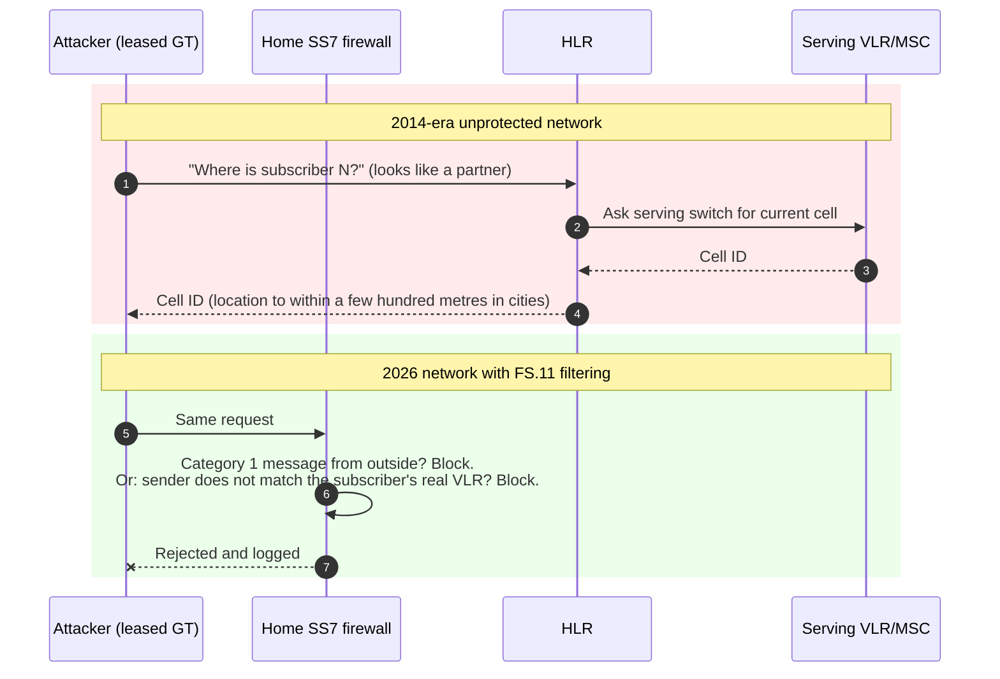

### Concept: why SMS one-time codes are not safe

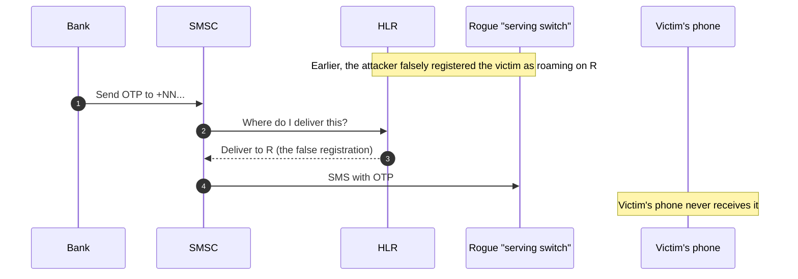

This is why the industry moved away from SMS one-time codes. It is also why, in 2017, criminals in Germany were able to [empty bank accounts](https://www.theregister.com/2017/05/03/hackers_fire_up_ss7_flaw/) after they had already stolen the victims' online-banking passwords.

---

## Does it still work in 2026?

**Short answer: yes, but less often, and increasingly through bypasses and leased access rather than "send one message and win".**

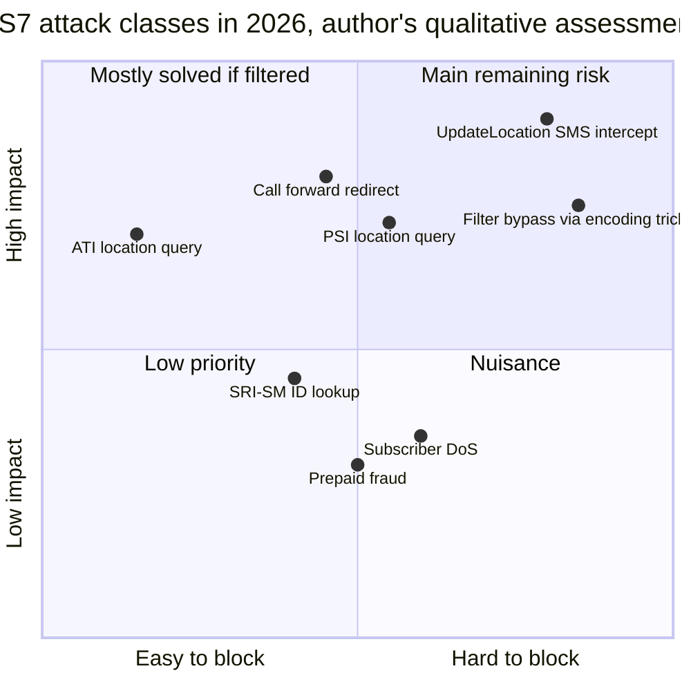

### What changed since 2014

| Then (2014–2017) | Now (2026) |
|---|---|
| Most operators had no SS7 filtering | Most large operators run SS7/Diameter firewalls and follow GSMA FS.11 / FS.19 |
| Category 1 messages (ATI) answered by many networks | Category 1 widely blocked at the border |
| SMS routing queries exposed real IMSI and switch addresses | SMS Home Routing hides them in many networks |
| SMS widely used for banking 2FA | Passkeys and app-based authentication are increasingly common, but SMS OTP is still common in many countries |
| Little public monitoring | Operators share threat intel through GSMA T-ISAC; vendors publish attack reports |

### What still works, according to public evidence

- **Location tracking against poorly protected networks.** Citizen Lab's [*Bad Connection*](https://citizenlab.ca/research/uncovering-global-telecom-exploitation-by-covert-surveillance-actors/) report (April 2026) documents two campaigns, including more than 15,000 location-tracking attempts since 2022. The attackers spoofed operator identities and switched entry points to get around defenses.
- **Firewall bypasses.** In July 2025, Enea [reported](https://techcrunch.com/2025/07/18/a-surveillance-vendor-was-caught-exploiting-a-new-ss7-attack-to-track-peoples-phone-locations) a surveillance vendor that used unusual TCAP encoding so that some firewalls could not parse, and therefore did not block, location queries. It worked against some carriers, not all.
- **Operator compromise.** Enea's November 2026 reporting on the group nicknamed **SilentAir** describes attackers inside telecom infrastructure. They issued SS7 and Diameter commands, including falsifying a subscriber's location to redirect SMS one-time codes. Targets were mostly in Taiwan ([Risky Bulletin](https://news.risky.biz/risky-bulletin-chinese-apt-uses-ss7-diameter-attacks-to-spy-on-targets/), [summary](https://thecybersecguru.com/news/silentair-ss7-attack-asian-mobile-operators/)).
- **US regulators take it seriously.** In 2024 the FCC [asked carriers](https://therecord.media/fcc-ss7-diameter-protocols-investigation) about SS7/Diameter location tracking. A CISA official [publicly disagreed](https://www.eff.org/deeplinks/2024/07/eff-fcc-ss7-vulnerable-and-telecoms-must-acknowledge) with carrier claims that no incidents had occurred.

### What usually does *not* work any more

- Sending ATI to a major carrier from an unknown partner.
- Expecting real IMSIs from SMS routing queries where Home Routing is deployed.
- The "buy SS7 access online" offers in forums and Telegram channels. These are almost always **scams**. If they are real, they are a direct route to a criminal case.

---

## Timeline of public incidents and research

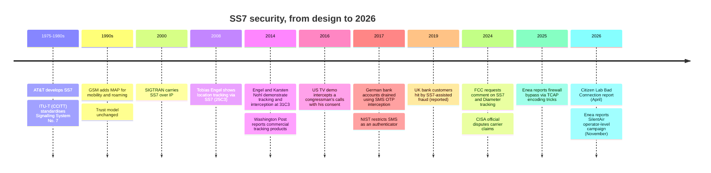

---

## Beyond SS7: Diameter, GTP and 5G

A common myth is that "4G/5G fixed it." They fixed some of it.

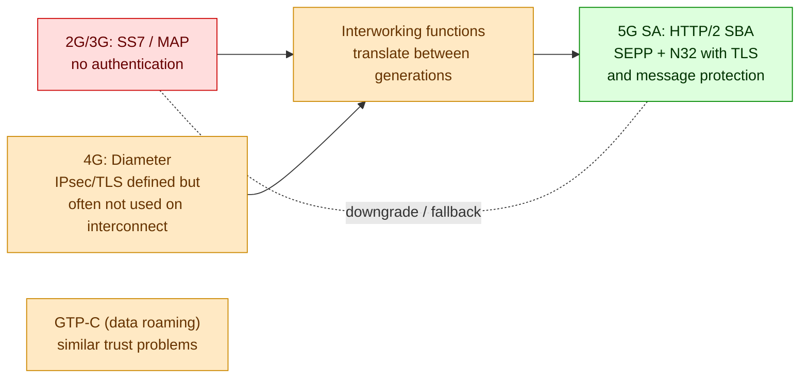

- **Diameter (4G)** has the same kind of operations, such as location requests and subscriber data updates. It is just as abusable if operators do not filter it. GSMA **FS.19** covers Diameter security.
- **GTP-C** is used for data roaming and has similar issues.
- **5G Standalone** adds the **SEPP** (Security Edge Protection Proxy). It authenticates partners and protects messages on the N32 interface. This is a real improvement, **but** only if both operators run 5G SA roaming, and only for traffic that never falls back to older generations.
- As long as 2G/3G and SS7 roaming exist, **the weakest generation sets the security level.**

---

## Defenses

### Defense in depth

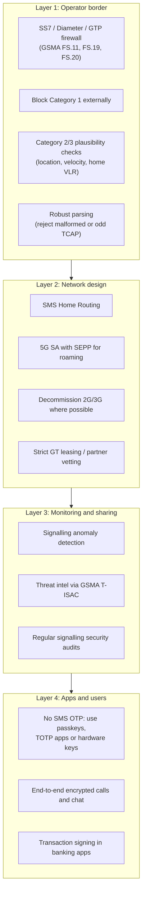

### What each group can actually do

| You are... | Do this |
|---|---|
| **An operator / telco security team** | Deploy and *tune* signalling firewalls for SS7, Diameter, and GTP. Implement FS.11 category checks. Enable SMS Home Routing. Vet every GT lease and sub-lease. Test your firewall against malformed encodings. Share indicators with GSMA T-ISAC. |
| **A bank, fintech, or app developer** | Stop using SMS OTP for login and high-value actions. Offer passkeys (WebAuthn). If you must keep SMS, add risk signals such as device binding and SIM-change checks, and never let SMS alone authorize a transfer. |
| **A journalist, activist, or high-risk person** | Use Signal or another end-to-end encrypted app for calls and messages. Use passkeys or a hardware key for important accounts. Remember that your phone's location can be exposed at the network level. A VPN does **not** protect against this. |
| **A regular user** | Switch your important accounts from SMS codes to an authenticator app or passkey. Use encrypted messaging. You cannot "patch" SS7 on your phone; it is on the network side. |

---

## Do's and don'ts

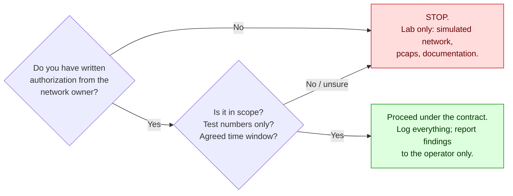

### ✅ Do

- Learn the protocols from the standards (3GPP TS 29.002 for MAP) and GSMA documents.
- Study **packet captures** in Wireshark. It has full dissectors for MTP3, M3UA, SCCP, TCAP, and MAP.
- Build an **isolated, virtual** lab with open-source core-network software. See [the next section](#a-safe-learning-lab).
- Work in telco security professionally: operator red teams, signalling-firewall vendors, and audits under contract.
- Report issues through responsible disclosure: the operator's security contact, the GSMA CVD programme, or your national CERT.
- Push your bank and apps to support passkeys.

### ❌ Don't

- **Don't buy "SS7 access"**, GT leases, or "SS7 tracking services" from brokers, forums, or Telegram. They are scams, illegal, or both. The buyer is the one who gets prosecuted.
- **Don't send any traffic into a real operator network** without a signed contract, even to "test your own number". Your number belongs to you; the network does not.
- **Don't track, intercept, or redirect** anyone's location, calls, or SMS. That includes partners, family members, and employees.
- **Don't transmit on mobile frequencies** with SDR or fake base stations without a spectrum licence. This is illegal in almost every country and can block emergency calls. Keep RF experiments in a shielded enclosure or skip RF entirely; core-network labs need none.
- **Don't publish working attack tooling or target-specific details** (live GTs, operator weaknesses) publicly. Report them privately.

---

## A safe learning lab

You can learn nearly everything about SS7 signalling **without touching a real network or a radio.**

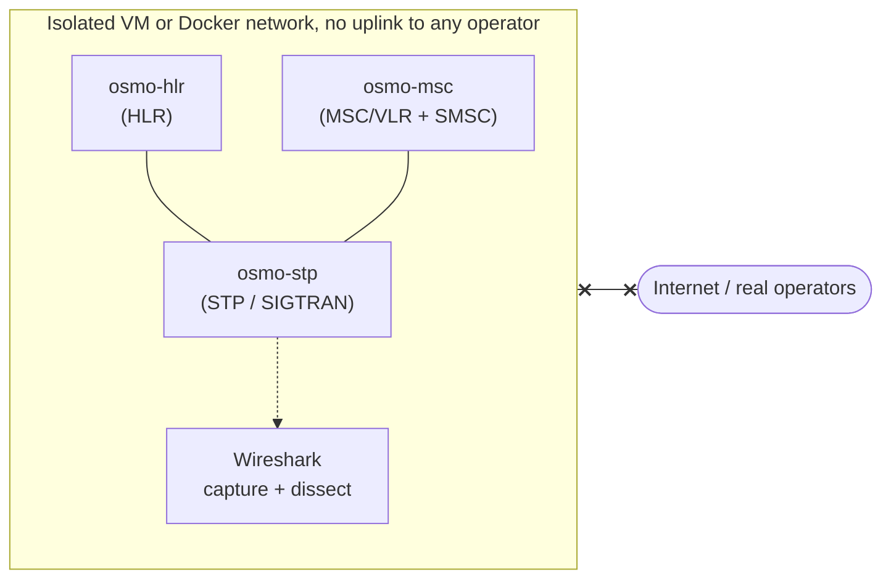

**Suggested path**

1. **Read** the MAP basics: what UpdateLocation, SendRoutingInfo, and MO/MT-ForwardSM *mean*. Start with the 3GPP TS 29.002 overview sections.
2. **Open sample captures** from the [Wireshark sample captures page](https://wiki.wireshark.org/SampleCaptures) (search for MAP, SCCP, or M3UA). Follow a TCAP dialogue from Begin to End.
3. **Run [Osmocom](https://osmocom.org/)** core components (`osmo-stp`, `osmo-hlr`, `osmo-msc`) in a **closed virtual network**. Watch how a simulated subscriber registers and receives an SMS. No radio is needed.
4. **Think like a defender.** For each message you see, ask: *"Should this ever arrive from another network? If yes, how would I check that it is plausible?"* That is exactly the logic of FS.11.
5. **Write a toy filter.** A small script that reads your lab capture and flags Category 1 messages from "external" GTs is a good exercise in defensive engineering.

---

## Common myths and misconceptions

Many SS7 write-ups online repeat claims that are inaccurate or outdated.

| Myth | Reality |
|---|---|
| Attackers intercept calls and SMS by changing the roaming number (MSRN) in transit. | Attackers do not edit an MSRN in transit. SMS interception works by **registering a false serving switch** for the victim (UpdateLocation), so the home network routes SMS there. Call redirection usually works by **changing forwarding or CAMEL settings** (InsertSubscriberData / RegisterSS). |
| 4G's Diameter protocol fixed SS7's security problems. | Diameter *allows* IPsec/TLS, but on interconnect it is often deployed without them. Without filtering, it is **just as abusable as SS7** (GSMA FS.19). The real improvement is 5G SA with SEPP. |
| Pegasus-style phone spying is an SS7 attack. | Pegasus is **device spyware** delivered through phone exploits. It is not an SS7 attack. Both are surveillance tools, but they work very differently. |
| Most caller-ID spoofing and spam SMS comes through SS7. | Most caller-ID spoofing and SMS spam today uses **VoIP and SMS aggregator routes**, not core SS7 manipulation. SS7 can be involved in SMS spoofing via SMSC abuse, but it is not the main channel. |
| IP spoofing and man-in-the-middle attacks on SIGTRAN are the main risk. | SCTP's handshake makes blind IP spoofing hard. The real SIGTRAN risk is **exposed or misconfigured equipment** and **legitimate-looking leased access**. |

---

## Glossary

| Term | Meaning |
|---|---|
| **ATI** | AnyTimeInterrogation: MAP query for a subscriber's state and location |
| **CAMEL / CAP** | Customised Applications for Mobile networks Enhanced Logic: service control (prepaid, call redirection) |
| **Diameter** | 4G signalling protocol that replaces MAP |
| **GT** | Global Title: SCCP address of a network element |
| **GTP-C** | GPRS Tunnelling Protocol, control plane: data-session signalling |
| **HLR / HSS** | Home Location Register (2G/3G) / Home Subscriber Server (4G): subscriber database |
| **IMSI** | International Mobile Subscriber Identity: the SIM's internal ID |
| **IPX / GRX** | Interconnect networks that link operators for roaming |
| **IRSF** | International Revenue Share Fraud |
| **ISUP** | ISDN User Part: call setup signalling |
| **MAP** | Mobile Application Part: mobility, SMS, subscriber management |
| **MSC / VLR** | Mobile Switching Centre / Visitor Location Register |
| **MSRN** | Mobile Station Roaming Number: temporary number used to route a call to a roaming subscriber |
| **MTP** | Message Transfer Part: classic SS7 transport layers 1–3 |
| **PSI** | ProvideSubscriberInfo: MAP request to the serving VLR for subscriber state and location |
| **SCCP** | Signalling Connection Control Part: Global Title routing |
| **SEPP** | Security Edge Protection Proxy: 5G roaming border security |
| **SIGTRAN** | SS7 over IP (M3UA, SUA, SCTP) |
| **SMSC** | Short Message Service Centre |
| **SRI / SRI-SM** | SendRoutingInfo / SendRoutingInfoForSM: routing lookups for calls and SMS |
| **STP** | Signal Transfer Point: SS7 router |
| **TCAP** | Transaction Capabilities Application Part: manages request/response dialogues |

---

## References

**Standards and industry guidance**
- 3GPP TS 29.002: *Mobile Application Part (MAP) specification*
- 3GPP TS 33.501: *Security architecture and procedures for 5G system*
- GSMA FS.11: *SS7 Interconnect Security Monitoring and Firewall Guidelines*
- GSMA FS.07: *SS7 and SIGTRAN Network Security*
- GSMA FS.19: *Diameter Interconnect Security*
- ENISA (2018): *Signalling Security in Telecom SS7/Diameter/5G*
- NIST SP 800-63B: [*Digital Identity Guidelines: Authentication*](https://pages.nist.gov/800-63-3/sp800-63b.html)

**Foundational research**
- Tobias Engel, *Locating Mobile Phones using SS7*, 25C3 (2008)
- Tobias Engel, *SS7: Locate. Track. Manipulate.*, 31C3 (2014)
- Karsten Nohl, *Mobile Self-Defense*, 31C3 (2014)

**Recent reporting (2024–2026)**
- Citizen Lab, [*Bad Connection: Uncovering Global Telecom Exploitation by Covert Surveillance Actors*](https://citizenlab.ca/research/uncovering-global-telecom-exploitation-by-covert-surveillance-actors/) (April 2026)
- TechCrunch, [Surveillance vendors caught abusing access to telcos](https://techcrunch.com/2026/04/23/surveillance-vendors-caught-abusing-access-to-telcos-to-track-peoples-phone-locations-researchers-say/) (April 2026)
- TechCrunch, [A surveillance vendor was caught exploiting a new SS7 attack](https://techcrunch.com/2025/07/18/a-surveillance-vendor-was-caught-exploiting-a-new-ss7-attack-to-track-peoples-phone-locations) (July 2025)
- Risky Bulletin, [Chinese APT uses SS7, Diameter attacks to spy on targets](https://news.risky.biz/risky-bulletin-chinese-apt-uses-ss7-diameter-attacks-to-spy-on-targets/) (2026)
- The Record, [FCC investigation into SS7 and Diameter](https://therecord.media/fcc-ss7-diameter-protocols-investigation) (2024)
- EFF, [FCC: SS7 is vulnerable, and telecoms must acknowledge that](https://www.eff.org/deeplinks/2024/07/eff-fcc-ss7-vulnerable-and-telecoms-must-acknowledge) (2024)
- CyberScoop, [Surveillance campaigns exploit long-known telecom vulnerabilities](https://cyberscoop.com/surveillance-campaigns-use-commercial-surveillance-tools-to-exploit-long-known-telecom-vulnerabilities/) (2026)

---

## License

Licensed under [CC BY 4.0](https://creativecommons.org/licenses/by/4.0/). See [LICENSE](LICENSE). You may share and adapt this with attribution. Please keep the educational-use disclaimer.

> **Reminder:** understanding a weakness is how defenders fix it. Using it against people who did not consent is how researchers end up in court. Stay on the right side of that line.
# ss7-signalling-security-guide
